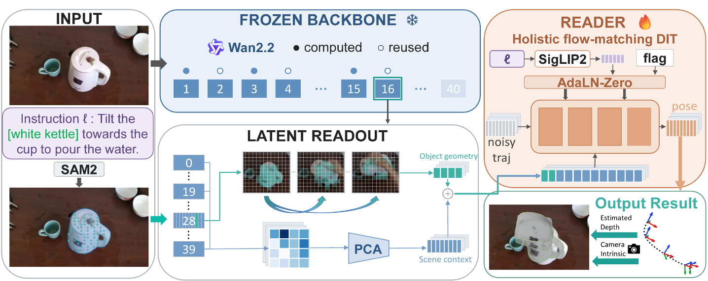
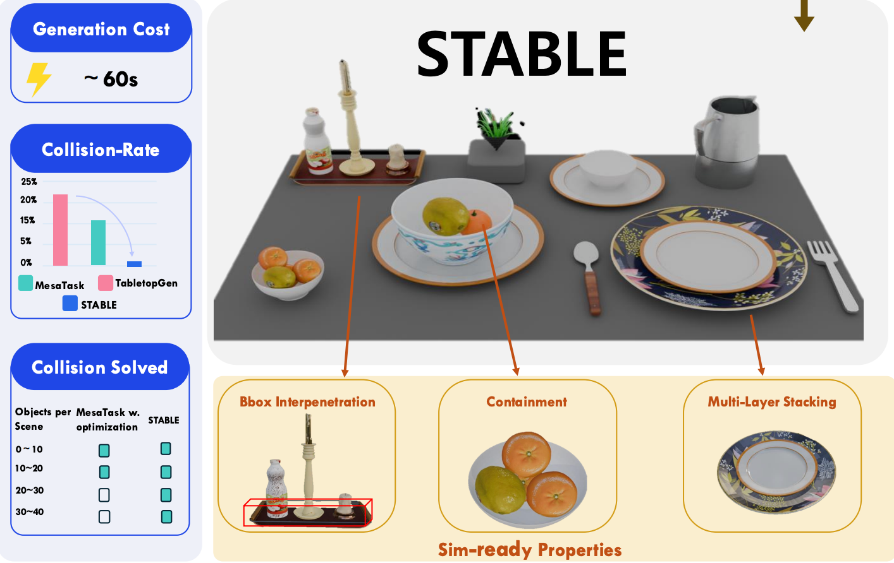
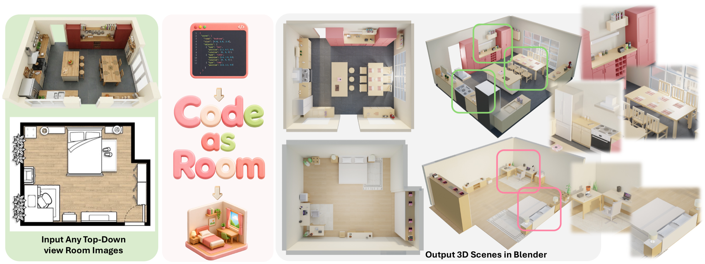
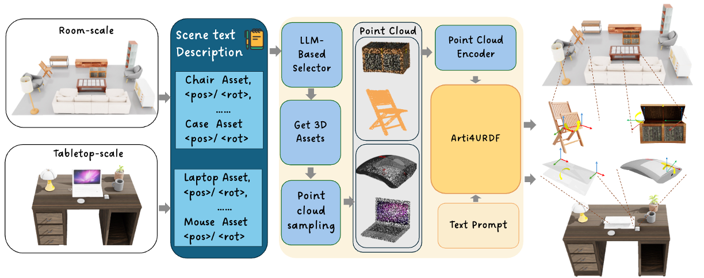
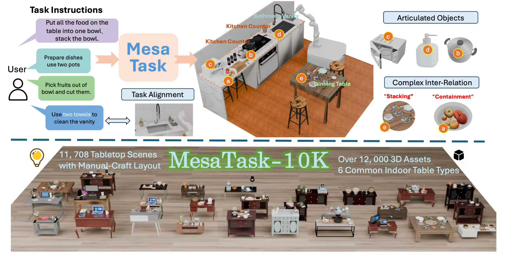
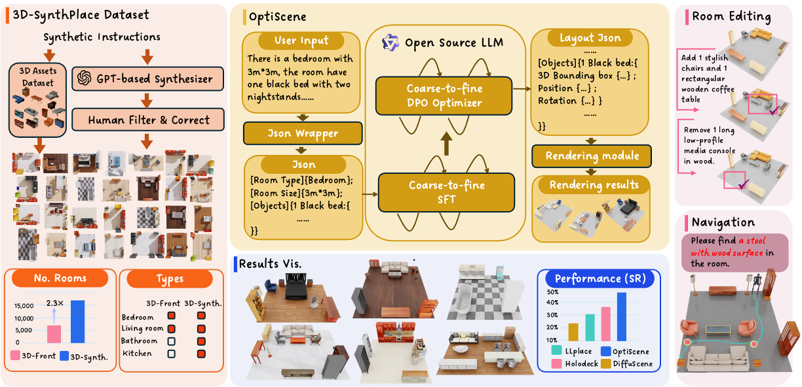
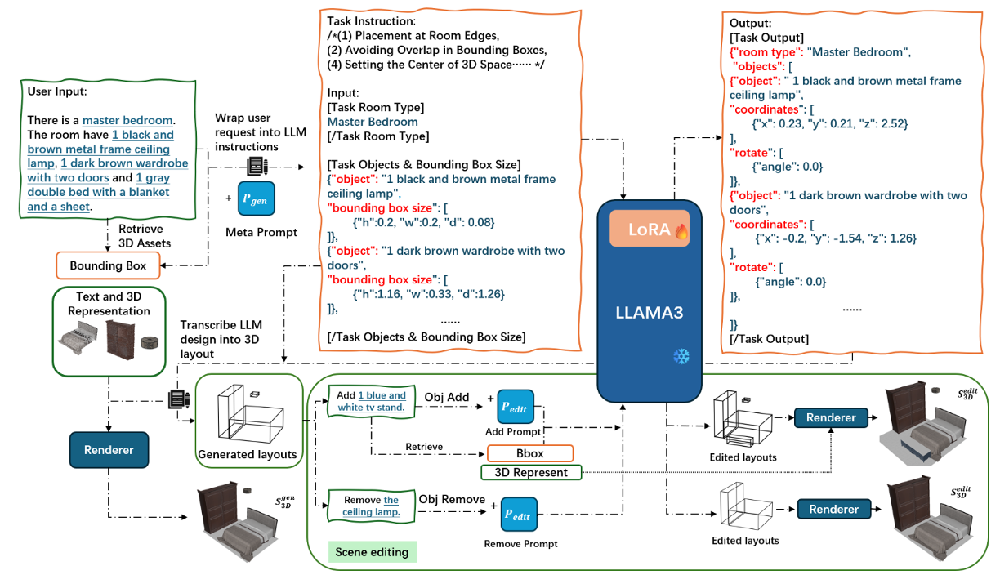
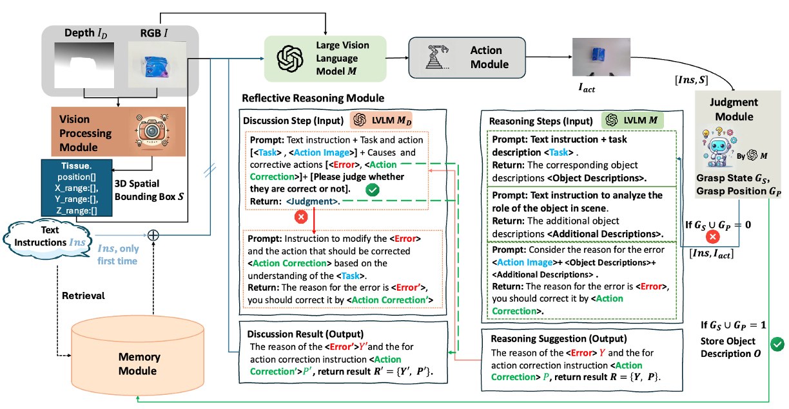
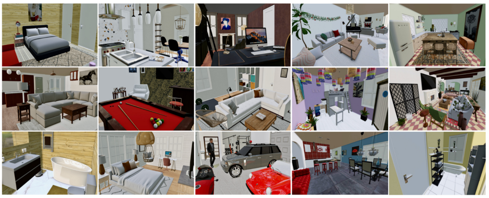
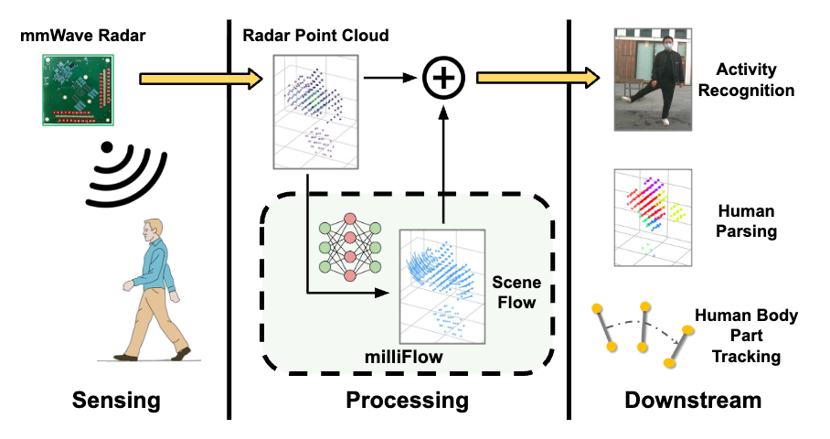

  

    
    <h1 class="main-heading">Zhen Luo</h1>

I am a third-year Ph.D. student jointly affiliated with the <a class="research-citation" href="https://www.sii.edu.cn/" target="_blank" rel="noopener">Shanghai Innovation Institute (SII)</a> and the <a class="research-citation" href="https://www.sustech.edu.cn/en/" target="_blank" rel="noopener">Southern University of Science and Technology (SUSTech)</a>, co-advised by <a class="research-citation" href="https://yanweifu.github.io/" target="_blank" rel="noopener">Prof. Yanwei Fu</a> and <a class="research-citation" href="https://faculty.sustech.edu.cn/fengzheng/en/" target="_blank" rel="noopener">Prof. Feng Zheng</a>.

My research focuses on generative simulation and multimodal world models for embodied intelligence.

<strong>Generative simulation for embodied AI:</strong> creating scalable, simulation-ready 3D environments and interactive assets for robot learning and evaluation.

<strong>Multimodal world models:</strong> developing predictive models of physical interactions from vision, touch, language, and action for contact-rich manipulation and planning.

Contact: <a href="mailto:lzhen0610@gmail.com">Email</a> / <a href="https://scholar.google.com/citations?user=hYXbJgcAAAAJ&hl=en" target="_blank" rel="noopener">Google Scholar</a>

Education
---------

<ul class="education-list">
  <li>
    <strong>Ph.D. in Computer Science</strong> @ <a href="https://www.sustech.edu.cn/en/" target="_blank" rel="noopener">SUSTech</a> & <a href="https://www.sii.edu.cn/" target="_blank" rel="noopener">SII</a>, 2024–Present 
    Advisors: <a href="https://yanweifu.github.io/" target="_blank" rel="noopener">Prof. Yanwei Fu</a> and <a href="https://faculty.sustech.edu.cn/fengzheng/en/" target="_blank" rel="noopener">Prof. Feng Zheng</a>
  </li>
  <li>
    <strong>MSc by Research in Informatics</strong> @ <a href="https://www.ed.ac.uk/" target="_blank" rel="noopener">University of Edinburgh</a>, 2022–2023 
    Advisor: <a href="https://christopherlu.github.io/" target="_blank" rel="noopener">Prof. Chris Xiaoxuan Lu</a>
  </li>
  <li>
    <strong>B.Eng. in Internet of Things Engineering</strong> @ <a href="https://www.bupt.edu.cn/" target="_blank" rel="noopener">BUPT</a>, 2017–2021
  </li>
</ul>

News
----

  <ul class="news-list">
    <li><em>2026.07</em> 🎉 One paper, <a href="https://arxiv.org/abs/2511.12977" target="_blank" rel="noopener">ArtiWorld</a>, is accepted to <a href="https://acmmm2026.org/" target="_blank" rel="noopener">ACM MM 2026</a>.</li>
    <li><em>2026.04</em> 🎉 One paper, <a href="https://lan555.github.io/stable/" target="_blank" rel="noopener">STABLE</a>, is accepted to <a href="https://icml.cc/Conferences/2026" target="_blank" rel="noopener">ICML 2026</a>.</li>
    <li><em>2025.09</em> 🎉 Two papers, <a href="https://mesatask.github.io/" target="_blank" rel="noopener"><strong>MesaTask</strong></a> and <a href="https://optiscene.github.io/" target="_blank" rel="noopener">OptiScene</a>, are accepted to <a href="https://neurips.cc/Conferences/2025" target="_blank" rel="noopener">NeurIPS 2025</a>. MesaTask is selected as a <strong>Spotlight (Top 2%)</strong>.</li>
  </ul>

Publications
------------

(* denotes equal contribution)

  

    

      
    

    

      <strong>DreamTraj: Generating 6-DoF Object Trajectories by Reading Unrendered Video Diffusion Latents</strong> 
      <i class="publication-authors">Tongsheng Ding*, <strong>Zhen Luo*</strong>, Yixuan Yang*, Boyu Wang, Luyang Xie, Jinyu Yang, Feng Zheng</i> 
      <i class="publication-venue">arXiv preprint, 2026</i>
      

        <a href="https://whathappen0.github.io/DreamTraj/" target="_blank" rel="noopener"><em>[project]</em></a>
        <a href="https://arxiv.org/abs/2608.00486" target="_blank" rel="noopener"><em>[paper]</em></a>
      

    

  

  

    

      
    

    

      <strong>STABLE: Simulation-Ready Tabletop Layout Generation via a Semantics-Physics Dual System</strong> 
      <i class="publication-authors"><strong>Zhen Luo*</strong>, Yixuan Yang*, Xudong Xu, Jinkun Hao, Zhaoyang Lyu, Feng Zheng, Jiangmiao Pang, Yanwei Fu</i> 
      <i class="publication-venue">International Conference on Machine Learning (<strong>ICML</strong>), 2026</i>
      

        <a href="https://lan555.github.io/stable/" target="_blank" rel="noopener"><em>[project]</em></a>
        <a href="https://arxiv.org/abs/2605.16137" target="_blank" rel="noopener"><em>[paper]</em></a>
      

    

  

  

    

      
    

    

      <strong>Code-as-Room: Generating 3D Rooms from Top-Down View Images via Agentic Code Synthesis</strong> 
      <i class="publication-authors">Yixuan Yang*, <strong>Zhen Luo*</strong>, Wanshui Gan*, Jinkun Hao, Junru Lu, Jinghao Yan, Zhaoyang Lyu, Xudong Xu</i> 
      <i class="publication-venue">arXiv preprint, 2026</i>
      

        <a href="https://code-as-room.github.io/" target="_blank" rel="noopener"><em>[project]</em></a>
        <a href="https://arxiv.org/abs/2605.18451" target="_blank" rel="noopener"><em>[paper]</em></a>
        <a href="https://github.com/YxuanAr/Code-as-Room" target="_blank" rel="noopener"><em>[code]</em></a>
      

    

  

  

    

      
    

    

      <strong>ArtiWorld: LLM-Driven Articulation of 3D Objects in Scenes</strong> 
      <i class="publication-authors">Yixuan Yang*, Luyang Xie*, <strong>Zhen Luo*</strong>, Zixiang Zhao, Tongsheng Ding, Mingqi Gao, Feng Zheng</i> 
      <i class="publication-venue">ACM International Conference on Multimedia (<strong>ACM MM</strong>), 2026</i>
      

        <a href="https://arxiv.org/abs/2511.12977" target="_blank" rel="noopener"><em>[paper]</em></a>
      

    

  

  

    

      
    

    

      <strong>MesaTask: Towards Task-Driven Tabletop Scene Generation via 3D Spatial Reasoning</strong> 
      <i class="publication-authors">Jinkun Hao*, Naifu Liang*, <strong>Zhen Luo*</strong>, Xudong Xu, Weipeng Zhong, Ran Yi, Yichen Jin, Zhaoyang Lyu, Feng Zheng, Lizhuang Ma, Jiangmiao Pang</i> 
      <i class="publication-venue">Advances in Neural Information Processing Systems (<strong>NeurIPS</strong>), 2025 (<strong>Spotlight</strong>)</i>
      

        <a href="https://mesatask.github.io/" target="_blank" rel="noopener"><em>[project]</em></a>
        <a href="https://arxiv.org/abs/2509.22281" target="_blank" rel="noopener"><em>[paper]</em></a>
        <a href="https://github.com/InternRobotics/MesaTask" target="_blank" rel="noopener"><em>[code]</em></a>
      

    

  

  

    

      
    

    

      <strong>OptiScene: LLM-driven Indoor Scene Layout Generation via Scaled Human-aligned Data Synthesis and Multi-Stage Preference Optimization</strong> 
      <i class="publication-authors">Yixuan Yang*, <strong>Zhen Luo*</strong>, Tongsheng Ding*, Junru Lu, Mingqi Gao, Jinyu Yang, Victor Sanchez, Feng Zheng</i> 
      <i class="publication-venue">Advances in Neural Information Processing Systems (<strong>NeurIPS</strong>), 2025</i>
      

        <a href="https://optiscene.github.io/" target="_blank" rel="noopener"><em>[project]</em></a>
        <a href="https://arxiv.org/abs/2506.07570" target="_blank" rel="noopener"><em>[paper]</em></a>
      

    

  

  

    

      
    

    

      <strong>LLplace: Embodied 3D Indoor Layout Synthesis Framework with Large Language Model</strong> 
      <i class="publication-authors">Yixuan Yang, Junru Lu, Zixiang Zhao, <strong>Zhen Luo</strong>, Wanxi Dong, Victor Sanchez, Feng Zheng</i> 
      <i class="publication-venue">IEEE/RSJ International Conference on Intelligent Robots and Systems (<strong>IROS</strong>), 2025</i>
      

        <a href="https://arxiv.org/abs/2406.03866" target="_blank" rel="noopener"><em>[paper]</em></a>
      

    

  

  

    

      
    

    

      <strong>RoboReflect: Robotic Reflective Reasoning for Grasping Ambiguous-Condition Objects</strong> 
      <i class="publication-authors"><strong>Zhen Luo</strong>, Yixuan Yang, Chang Cai, Yanfu Zhang, Feng Zheng</i> 
      <b><i class="publication-venue">arXiv 2025</i></b>
      

        <a href="https://arxiv.org/abs/2501.09307" target="_blank" rel="noopener"><em>[paper]</em></a>
      

    

  

  

    

      
    

    

      <strong>InfiniteWorld: A Unified Scalable Simulation Framework for General Visual-Language Robot Interaction</strong> 
      <i class="publication-authors">Pengzhen Ren*, Min Li*, <strong>Zhen Luo*</strong>, Xinshuai Song*, Ziwei Chen*, Weijia Liufu*, Yixuan Yang*, et al.</i> 
      <b><i class="publication-venue">arXiv 2024</i></b>
      

        <a href="https://arxiv.org/abs/2412.05789" target="_blank" rel="noopener"><em>[paper]</em></a>
        <a href="https://github.com/pzhren/InfiniteWorld" target="_blank" rel="noopener"><em>[code]</em></a>
      

    

  

  

    

      
    

    

      <strong>milliFlow: Scene Flow Estimation on mmWave Radar Point Cloud for Human Motion Sensing</strong> 
      <i class="publication-authors">Fangqiang Ding, <strong>Zhen Luo</strong>, Peijun Zhao, Chris Xiaoxuan Lu</i> 
      <i class="publication-venue">European Conference on Computer Vision (<strong>ECCV</strong>), 2024</i>
      

        <a href="https://arxiv.org/abs/2306.17010" target="_blank" rel="noopener"><em>[paper]</em></a>
        <a href="https://github.com/Toytiny/milliFlow" target="_blank" rel="noopener"><em>[code]</em></a>
      

    

  

